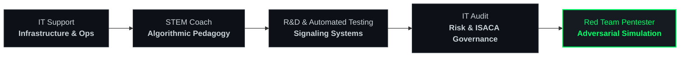

<div align="center">

# Hercules KEUNG
### Red Teaming Consultant & Hardware/AI System Builder

[](https://git.io/typing-svg)

<p align="center">
  
  
  
  
</p>

---

</div>

## Career Trace & Evolution

From foundational infrastructure and algorithmic pedagogy to risk governance and adversarial exploitation.



---

## Operational Arsenal & Tech Stack

```text
[OFFENSIVE & SECURITY]
├── Mobile Assessment ── Frida ── JADX ── ADB ── mitmproxy ── OWASP MASVS
├── Network & Host    ── Kali Linux ── Burp Suite ── Metasploit ── Wireshark ── Nmap
└── Low-Level/Kernel  ── Linux sk_buff ── Packet Analysis ── VMware Workstation

[SYSTEMS & INTELLIGENCE]
├── Core Development  ── Python (uv / FastAPI / SQLAlchemy) ── C/C++ ── Bash
├── AI & Data Science ── Classical ML (Scikit-Learn / KNN / K-Means) ── Pandas ── OpenCV
└── Embedded / IoT    ── ESP32-S3 ── MicroPython ── ROS ── FreeRTOS ── Hardware Modding
```

<p align="left">
  
  
  
  
  
  
  
</p>

---

## Shipped Architecture & Mission Logs

### 01. Adversarial Simulation & Mobile Security
* **Target Vectors**: Android application decompilation, TLS unpinning scripts, dynamic memory instrumentation using Frida runtime injection.
* **Security Automation**: LLM-assisted penetration testing tooling, automated vulnerability verification pipelines, and network packet monitoring micro-labs.

### 02. AI-Driven Edge & Educational Robotics (ORZAI / AICube)
* **Architecture**: Modular 3D-printed robotics platform powered by an **ESP32-S3** core.
* **Software Core**: Block-based visual machine learning compiler, interactive simulation environments, and local AI agent dialogues.

### 03. High-Performance Tooling & Workflows
* **Microservices**: Python package architectures utilizing ultra-fast `uv` workspace environments.
* **Autonomous Workflows**: Mission Control dashboards enforcing development architecture gates and event-driven automation bots.

---

## Telemetry & Execution Grid

<div align="center">
  <a href="https://github.com/Hercules03">
    
    
  </a>
</div>

<div align="center">
  
</div>

---

<div align="center">

```text
[EOF] - Initiating secure session logout... Connection verified.
```

**[LinkedIn](https://www.linkedin.com/in/hercules-keung/)** • **[Email](mailto:herculeskeung03@gmail.com)** • **[GitHub](https://github.com/Hercules03)**

</div>
