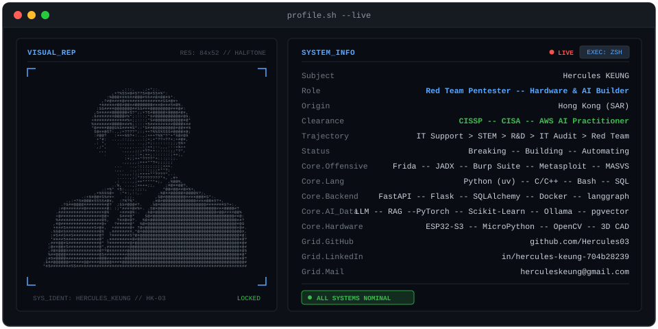
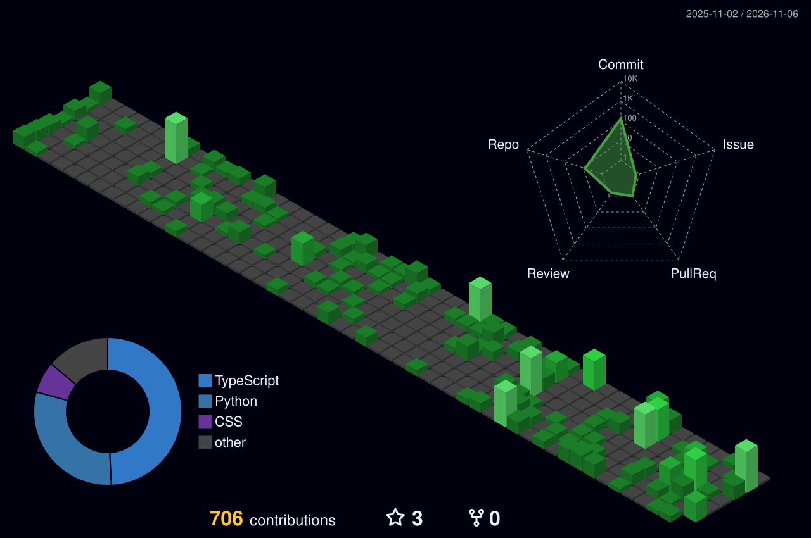

<div align="center">



<p align="center">
  
  
  
  
</p>

<p align="left">
  
  
  
  
  
  
  
</p>

---

## Shipped Architecture & Mission Logs

### 01. Adversarial Simulation & Mobile Security
* **Target Vectors**: Android application reverse engineering, dynamic memory hook injections via Frida, and TLS unpinning bypasses.
* **Security Automation**: LLM-assisted penetration testing tooling, automated vulnerability verification pipelines, and network packet monitoring micro-labs.

### 02. High-Performance Tooling & Workflows
* **Microservices**: High-performance Python package architectures utilizing ultra-fast `uv` workspace environments.
* **Autonomous Workflows**: Mission Control dashboards enforcing pre-development architecture gates and event-driven automation bots.

---

## Activity Telemetry & Threat Surface Grid

<div align="center">
  <picture>
    <source media="(prefers-color-scheme: dark)" srcset="https://raw.githubusercontent.com/Hercules03/Hercules03/output/github-contribution-grid-snake-dark.svg">
    <source media="(prefers-color-scheme: light)" srcset="https://raw.githubusercontent.com/Hercules03/Hercules03/output/github-contribution-grid-snake.svg">
    
  </picture>
</div>

<details>
  <summary><b>Click to Inspect 3D Architecture Skyline</b></summary>
  <br/>
  <div align="center">
    
  </div>
</details>

---

## Telemetry & Execution Grid

<div align="center">
  <a href="https://github.com/Hercules03">
    
  </a>
</div>

---

<div align="center">

```text
[EOF] - Initiating secure session logout... Connection verified.
```

**[LinkedIn](https://www.linkedin.com/in/hercules-keung-704b28239/)** | **[Email](mailto:herculeskeung@gmail.com)** | **[GitHub](https://github.com/Hercules03)**

</div>